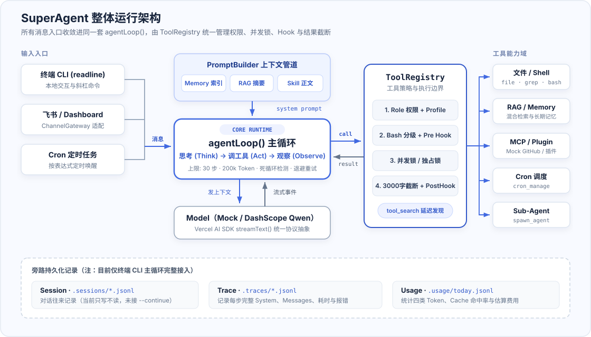

# SuperAgent

一个用 TypeScript 写的 **从 0 到 1 学习 AI Agent** 的教学仓库。不依赖黑盒框架，用不到 7,000 行源码完整拆解一个本地 Agent Runtime 是怎么从“调用模型”一步步长成完整系统的。

配合仓库自带的源码学习手册，你可以边跑代码边吃透每一层设计：
- 在线阅读：[SuperAgent 源码学习手册](https://th1humble.github.io/SuperAgent/learning/)
- 仓库内阅读：[docs/learning/README.md](docs/learning/README.md)



## 这个仓库实现了哪些功能

按从 0 到 1 的学习顺序，仓库覆盖了 AI Agent 的核心模块：

- **Agent Loop**：流式对话、`思考 → 调工具 → 观察` 多步闭环、指数退避重试与死循环检测
- **工具系统**：文件读写、代码搜索、`bash`、网页抓取，支持并发/独占锁、结果截断和 `tool_search` 延迟发现
- **上下文工程**：`PromptBuilder` 模块化拼接、Prompt Cache 模拟、`/context` 窗口占用可视化与防线清理
- **RAG 与长期记忆**：文档切片、向量 + BM25 + MMR 混合检索，以及 `.memory/` Markdown 持久化记忆
- **扩展与多端接入**：`.skills/` 技能加载、进程内插件、MCP 协议客户端、飞书 Bot 与本地通道调试页
- **安全与自主运行**：三档角色权限、Pre/Post Hook、Bash 危险命令拦截、Cron 定时任务、Sub-Agent 并行分治与执行 Trace

## 怎么启动（默认 Mock 模式，免 API Key）

环境要求 **Node.js 22** 和 **pnpm 10.33.0**：

```bash
pnpm install
pnpm start
```

不配置任何 Key 时，项目**默认使用内置的 Mock 模型和本地 Mock 向量**，装完就能直接跑通主链路。看到终端的 `You:` 提示符后可以试试：

- `读取 package.json` —— 观察模型如何走两个 Step 完成一次工具调用
- `测试并发` —— 观察多个只读工具如何并行执行
- `/context`、`/rag` —— 查看上下文占用矩阵和自动导入的演示知识库
- `exit` —— 退出程序

> **启动时看到的 `http://localhost:3000` 是干嘛的？**
> 它不是网页版聊天窗口，而是 **飞书消息通道的本地模拟调试页**——没配真实飞书机器人时，可以在页面里查看通道状态，或模拟发一条飞书消息来验证“外部消息接入同一套 Agent Loop”的流程（回复会打印在终端里）。平时只在终端里聊，忽略它即可；如果 3000 端口冲突，在 `.env` 里改 `FEISHU_PORT=3001`。

## 接入真实模型

### 1. 默认接入的模型（阿里云百炼 DashScope / 通义千问）

初始化向导和 RAG 向量化默认对接 **DashScope**（对话默认 `qwen-plus-latest`，RAG 向量默认 `text-embedding-v3`），只需配一个 `DASHSCOPE_API_KEY` 就能跑通全部功能：

```bash
cp -n example.env .env
pnpm run init
```

1. 跑 `pnpm run init` 时，**API Key 这一步直接回车留空**（会在 `super-agent.config.json` 中自动写入 `"${DASHSCOPE_API_KEY}"` 引用）；
2. 打开 `.env` 填入真实的 `DASHSCOPE_API_KEY=sk-xxx`，再执行 `pnpm start`。

> 只填 `.env` 不生成 `super-agent.config.json` 不会生效——程序看的是配置里 `model.apiKey` 替换后是否非空。

### 2. 如果要换成你自己的模型（任意 OpenAI 兼容接口）

对话层底层使用 `@ai-sdk/openai`，只要你的模型提供 **OpenAI 兼容接口**（如 DeepSeek、OpenAI、Ollama、OpenRouter 等）都可以直接接入：

1. 仓库默认没有 `super-agent.config.json`（已被 `.gitignore` 忽略）。可以先运行 `pnpm run init` 生成后修改 `model` 字段，或者**直接在项目根目录新建 `super-agent.config.json`**，只写下面这 4 个字段即可（其余配置会自动用默认值）：
   ```json
   {
     "model": {
       "provider": "openai",
       "name": "deepseek-chat",
       "baseURL": "https://api.deepseek.com/v1",
       "apiKey": "${MY_LLM_API_KEY}"
     }
   }
   ```
   （`provider` 可选 `"dashscope"` / `"openai"` / `"custom"`，`name` 和 `baseURL` 换成你对应厂商的模型 ID 和接口地址。）
2. 在 `.env` 中填入对应密钥：`MY_LLM_API_KEY=sk-xxx`。
3. **注意处理 RAG Embedding**：目前 `src/main.ts` 检测到 `model.apiKey` 非空时，会默认拿这同一个 Key 去调 `src/rag/embedder.ts` 里写死的 DashScope 向量接口。换成其它厂商的 Key 后，启动自动索引 `docs/*.md` 时会报 `401`——把 `src/main.ts` 里的 `embedFn` 改回 `createMockEmbedder()`，或把 `src/rag/embedder.ts` 改成你自己的 Embeddings 接口地址即可。

> 飞书 Bot、网页搜索（Tavily / Serper）等属于可选功能，按需参考 [example.env](example.env) 配置。

## License

ISC
