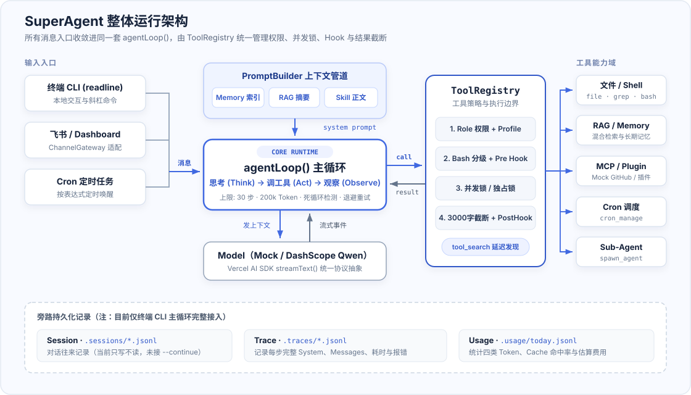
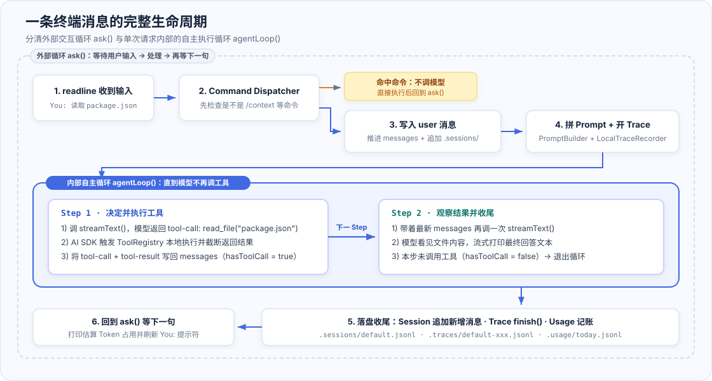

# 00. 阅读指南与整体架构

读源码最怕一上来就扎进细节里迷路。这一章先不看任何具体算法，只做三件事：搞清 SuperAgent 到底是个什么东西、看懂它的模块地图、跟着一条终端消息从输入到输出走完一圈。

## 0.1 SuperAgent 是什么

平时在网页上用的聊天机器人，流程基本是单向的：**你发一句 → 模型回一句**。

SuperAgent 是一个本地运行的 **Agent Runtime（智能体运行时）**。在这里，大语言模型只是“大脑”，真正让它能读写文件、查资料、跑命令的，是外围包着的那一整套工程壳子：

```text
用户输入 → 组装上下文 → 调用模型 → 解析模型输出 → (如果模型要求调工具) 本地执行工具
   ↑                                                                │
   └──────────────────────── 把工具执行结果塞回历史，再次问模型 ─────────┘
```

只要模型还在“要工具”，这个循环就继续转；直到模型觉得信息够了、不再请求工具、直接输出回答文本，这一轮交互才算结束。

## 0.2 技术栈与几个高频词

项目总共依赖十来个包，全部围绕“用最少代码跑通 Agent”来选：

| 技术 | 在项目里的角色 | 顺带解释给新手 |
| --- | --- | --- |
| TypeScript + ESM | 源码语言与模块规范 | ESM 即 `import/export` 语法，注意 TS 里导入本地文件也要写 `.js` 后缀（如 `'./main.js'`），这是 Node ESM + TS 的常见约定 |
| Node.js 22 + `tsx` | 运行环境 | `tsx` 能直接执行 `.ts` 文件，省去了先 `tsc` 编译再跑的 `build` 步骤 |
| Vercel AI SDK (`ai`) | 统一模型与工具协议 | 抹平不同厂商的流式格式和工具调用格式，让业务代码不用重写 |
| `@ai-sdk/openai` | 连接模型接口 | DashScope（通义千问）兼容 OpenAI 协议，所以直接复用这个适配器并替换 `baseURL` |
| Zod | 配置校验 | 用来检查 `super-agent.config.json` 格式对不对、缺字段时自动填默认值 |
| Hono | 轻量 HTTP 框架 | 用来起本地 3000 端口的 Channel Dashboard 网页 |
| `@larksuiteoapi/node-sdk` | 飞书机器人 SDK | 建立飞书长连接，把飞书群/私聊消息接进来 |
| Croner | 定时表达式解析 | 算清楚 `0 9 * * *` 下一次该什么时候触发 |
| Turndown | HTML 转 Markdown | 抓取网页后把乱七八糟的 HTML 标签洗成模型更好读的 Markdown |

## 0.3 目录地图

全仓库源码都在 `src/` 下，按职责拆成十几块，每块都只有两三个文件：

```text
SuperAgent/
├── src/
│   ├── index.ts         CLI 入口：判断是跑 init 还是正常启动
│   ├── main.ts          总装配车间：把所有模块创建出来并串在一起
│   ├── mock-model.ts    无 API Key 时的假模型（按关键词模拟流式输出和工具调用）
│   ├── agent/           主 Agent Loop、错误重试、死循环检测
│   ├── agents/          子 Agent 的状态记录与并行派发
│   ├── tools/           ToolRegistry（注册/权限/锁/Hook/截断）、内置工具、MCP
│   ├── context/         PromptBuilder 管道、压缩器、即时防线、/context 矩阵视图
│   ├── session/         把对话按行写进 .sessions/*.jsonl
│   ├── usage/           统计每步 Token 消耗与估算费用
│   ├── memory/          .memory/ 下的 Markdown 长期记忆、BM25 搜索与体检
│   ├── rag/             文档切片、Embedding、内存向量库、混合检索
│   ├── skills/          从 .skills/ 加载技能文档并拼进 Prompt
│   ├── plugins/         进程内插件生命周期与 Supabase 示例
│   ├── channels/        通道网关、飞书接入、Dashboard HTTP 服务
│   ├── security/        三档角色权限、Pre/Post Hook 管线、Bash 危险命令拦截
│   ├── cron/            定时任务的解析、持久化与定时器调度
│   ├── commands/        终端斜杠命令分发器和各领域命令
│   ├── config/          Zod Schema、JSON 配置加载与交互式 init 向导
│   └── trace/           把每一步发给模型的完整现场写进 .traces/*.jsonl
├── .skills/             自带技能示例（code-review）
├── docs/                RAG 演示文档（顶层）+ 本学习手册（learning/）
├── example.env          环境变量模板
└── package.json         依赖与启动脚本
```

## 0.4 模块之间怎么连起来

如果把启动后的系统画成一张静态接线图，核心流向是这样的（点击图片可放大）：



这里最核心的设计原则是**收敛**：不管消息是从终端打进来的、从飞书发过来的，还是定时任务半夜触发的，最终调用的都是同一套 `agentLoop()` 和 `ToolRegistry`。区别仅在于外围的记录（目前只有终端主交互接上了 Session 和 Trace）。

## 0.5 为什么先读 `src/main.ts`

软件工程里常把 `main.ts` 这种文件叫 **Composition Root（组合根）**——听着吓人，其实就是**“整个项目的总装配车间”**。

每个子模块（比如 `CronService`、`ToolRegistry`、`MemoryStore`）自己只干一件事，互相尽量不写死依赖；最后全在 `src/main.ts` 里被 `new` 出来，再像插积木一样互相传进去：

1. 读 `.env` 和 `super-agent.config.json`；
2. 看 `config.model.apiKey` 有没有值，决定创建 Mock 还是真实模型；
3. 创建 `ToolRegistry`，先把内置工具和 `tool_search` 注册进去；
4. 初始化 `MemoryStore`、`VectorStore`，把记忆工具和 RAG 工具注册进去；
5. 准备好 Skill 加载器、插件管理器、Pre/Post Hook 管线；
6. 创建 `CronService` 和 `SubAgentRegistry`，把对应的管理工具也挂进 `ToolRegistry`；
7. 用 `PromptBuilder` 把各个信息源串联成 System Prompt 生成器；
8. 建好 `ChannelGateway` 并挂上飞书/Dashboard；
9. 把所有斜杠命令汇总给 `createDispatcher()`；
10. 调用 `startAgent()`：连接 Mock MCP → 加载插件 → 启动 Channel → 启动 Cron → 导入 `docs/*.md` 到知识库 → 进入终端提问循环 `ask()`。

以后你看任何模块晕头转向，不知道“这玩意是谁创建、什么时候启动、参数哪来的”，直接搜它在 `src/main.ts` 里的调用位置，一下就通了。

## 0.6 一条终端消息的完整生命周期

当你在 `You:` 后面敲入一句普通的话（比如 `读取 package.json`）并回车，背后会经历以下流转（点击图片可放大）：



新手很容易把两个循环搞混，一定要分清：
- **`ask()`**：人与程序的**外部多轮对话循环**（你问一句，它忙完回你，再等你问下一句）。
- **`agentLoop()`**：单次请求内部的**自主执行循环**（为了回答你这一句话，模型自己反复调工具、看结果、再调工具，直到得出答案）。

## 0.7 把五花八门的状态分个类

写 Agent 最容易乱的是“状态存哪儿、重启还在不在”。先把当前仓库里的状态按生命周期列清楚：

| 状态 | 活多久 | 当前存在哪 | 进程退出会怎样 |
| --- | --- | --- | --- |
| 单次 Step 中间变量 | 一次模型调用 | `agentLoop` 局部变量、`.traces/` | 内存销毁，Trace 文件保留供复盘 |
| 当前对话历史 | 本次 CLI 运行期 | `messages` 数组、`.sessions/default.jsonl` | **注意**：文件虽保留，但重启目前不会自动读回 |
| 长期记忆 | 跨会话永久留存 | `.memory/*.md` + `MEMORY.md` | 下次启动重新读索引，记忆还在 |
| RAG 向量索引 | 仅限当前进程 | 内存 `VectorStore` | 退出即清空，下次启动重新切分 `docs/*.md` |
| 定时任务 | 配置持久 + 定时在内存 | `.cron/jobs.json` + Node 定时器 | 重启会重新加载，但关机期间错过的不会补跑 |
| 子 Agent 记录 | 仅限当前进程 | `SubAgentRegistry` 内存 Map | 退出即清空 |

## 0.8 本章自检

合上上面内容，试着用自己的话回答这 5 个问题（点开可看参考思路）：

1. `src/index.ts` 和 `src/main.ts` 为什么拆成两个文件？
2. 为什么说 `main.ts` 是“装配车间”？它和业务模块怎么分工？
3. `ask()` 和 `agentLoop()` 各自负责哪一层的循环？
4. 为什么重启后记忆（Memory）还在，但聊过的对话（Session）和 RAG 索引却没了？
5. 飞书发来的消息和终端输入的消息，是在哪一层汇合的？

<details>
<summary>参考思路（点击展开）</summary>

1. `src/index.ts` 只有 6 行，负责区分 `pnpm run init` 和正常启动并**动态 import** 对应文件。这样跑初始化向导时不会提前触发 `main.ts` 顶层的一堆初始化和副作用。
2. `main.ts` 不写具体的检索、压缩或权限算法，只负责把各模块实例化并互相传递依赖（Composition Root），让子模块保持独立可测。
3. `ask()` 是外部“人机交互”循环（等用户输入一条）；`agentLoop()` 是单次请求内部的“思考-调工具-观察”循环（可能连跑好几步才把最终文本交还给 `ask()`）。
4. Memory 启动时会读 `.memory/` 重建索引；Session 虽然写了 `.sessions/default.jsonl`，但 `main.ts` 每次启动都是 `let messages = []`，尚未接入 `SessionStore.load()`；RAG 的 `VectorStore` 纯在内存，没有接持久化向量库。
5. 在 `agentLoop()` 和 `ToolRegistry` 汇合。`ChannelGateway` 收到外部消息后，也是组装 `system` 后直接调用 `agentLoop(model, registry, messages, system)`。

</details>

下一章我们直接拆开最核心的引擎：`agentLoop` 到底是怎么用十来行核心逻辑把模型变成“能干活的 Agent”的。
