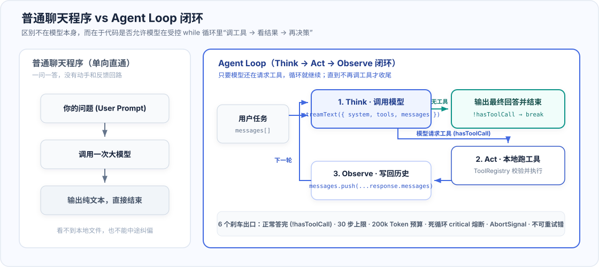

# 01. 从模型调用到 Agent Loop

几乎所有 Agent 框架看起来都很复杂，但剥到最里面，核心往往只有一个 `while` 循环。这一章看懂了，后面所有的工具、记忆、子 Agent 都是往这个循环里塞素材。

## 1.1 为什么普通聊天程序不是 Agent

普通聊天程序（比如早期的 API Demo）只有一锤子买卖，而 Agent 多了一个**“动手 + 看结果再决定”**的回路（点击图片可放大）：



所以决定一个程序是不是 Agent 的，往往**不是模型参数量有多大，而是代码里有没有给模型一个受控的循环，让它能根据工具反馈继续做下一步决策**。

## 1.2 模型抽象：为什么能无痛切换 Mock 和 Qwen

看 `src/main.ts`：

```ts
function createModel(cfg: SuperAgentConfig['model']) {
  if (!cfg.apiKey) return createMockModel();
  const provider = createOpenAI({ baseURL: cfg.baseURL, apiKey: cfg.apiKey });
  return provider.chat(cfg.name);
}
```

这里用了一个很工程化的做法：**把“模型是谁”隔离在入口处**。后面的 `agentLoop` 只认 Vercel AI SDK 的统一模型接口，它根本不知道背后接的是通义千问，还是本地写的 `createMockModel()`。

顺便提醒一句：很多国内模型（包括 DashScope）都号称“兼容 OpenAI 协议”，这能让你直接用 `@ai-sdk/openai` 换个 `baseURL` 就连上，但不代表所有细节都 100% 一致——比如 Prompt Cache 字段格式、并行工具调用的稳定程度、报错码规范，真接新模型时还是要实测一遍。

## 1.3 `mock-model.ts` 到底是怎么假装自己是模型的

`src/mock-model.ts` 有 600 行，是全仓库最大的单文件。它当然没有跑神经网络，而是**假装成一个标准的 AI SDK v2 模型对象**，实现 `doStream()` 和 `doGenerate()` 方法，根据你输入里的关键词，按事先写好的规则吐出流式数据块（`text-delta`、`tool-call`、`finish`）和模拟的 `usage`。

它的意义在于：即使没有 API Key、断网或者不想花钱，整个程序依然会**原封不动地走一遍 Vercel AI SDK 的参数校验、工具执行器、消息追加和 Trace 写入**，不会跳过任何运行时代码。

但新手一定要注意它的边界：
- **它只会按关键词触发固定几条规则**（比如看到 `测试并发` 就吐三个工具调用，看到 `部署` 就调 `rag_search`）；
- **它只能走有限步数**：大多数普通工具调用在收到一次 `tool-result` 后（`hasToolResults(prompt)` 为 `true`），就会在下一轮直接吐文字收尾（唯一做了多步编排的是 `/dream` 记忆整理和 `tool_search` 延迟发现）；
- 它**没有内置 Cron 和 Sub-Agent 的触发词**，也不能用来测试“模型到底聪不聪明”。

## 1.4 为什么历史消息是个数组，而且结构越来越复杂

大语言模型本身是**无状态**的——它不会在服务端替你记住上一轮聊过什么。每次调接口，程序都得把历史聊天记录打包成一个 `ModelMessage[]` 数组重新发过去：

```ts
const messages: ModelMessage[] = [
  { role: 'user', content: '我叫小明' },
  { role: 'assistant', content: '你好，小明' },
  { role: 'user', content: '我叫什么？' },
];
```

一旦引入工具调用，数组里就不再只是纯字符串了，还会出现结构化数组部件（比如 `assistant` 消息里夹着 `{ type: 'tool-call', ... }`，`tool` 消息里装着 `{ type: 'tool-result', ... }`）。

这也是为什么你在 `src/main.ts`、`src/mock-model.ts`、`src/context/view.ts` 里老能看到代码在小心翼翼地判断 `typeof content === 'string'` 还是 `Array.isArray(content)`——只按字符串处理，一调工具就会报错。

四类常见角色各自的分工：
- `system`：总规则和实时上下文（项目里作为 `streamText` 的独立 `system` 参数传入，不混在 `messages` 里）；
- `user`：用户的输入（另外循环检测发出警告时，代码也会临时塞一条带 `[系统提醒]` 的 `user` 消息劝模型换思路）；
- `assistant`：模型的文本回复或工具调用请求；
- `tool`：本地执行完工具后包好的结果。

## 1.5 流式输出与事件解析

同步请求要等模型把整段话憋完才返回，用户盯着黑屏体验很差。项目用的是 `streamText()`，边生成边吐事件流 `result.fullStream`。

看 `src/agent/loop.ts`，主循环主要盯住三类事件：

| 事件类型 | 什么时候触发 | 代码干了什么 |
| --- | --- | --- |
| `text-delta` | 模型新吐出几个字 | 立刻 `process.stdout.write` 打到终端，并拼到 `fullText` |
| `tool-call` | 模型决定调某个工具 | 打印 `[调用: 工具名(参数)]`，做死循环检测并记入历史 |
| `tool-result` | 本地工具跑完返回结果 | 打印前 120 字符预览，把结果哈希也记进循环检测器 |

**初学者最容易写错的一点**：别以为把 `fullText` 拼进 `messages` 就够了。真正包含完整 `tool-call` 和 `tool-result` 结构的标准消息，必须等流结束后取 `const stepResponse = await result.response`，然后用 `messages.push(...stepResponse.messages)` 存下来。`fullText` 只适合打印和给 Trace 做文本摘要。

## 1.6 拆开 `agentLoop` 的骨架

把 `src/agent/loop.ts` 剥掉日志和异常处理，核心骨架其实非常直白：

```ts
while (step < stepLimit) {
  step++;
  // 1. 带着 system、tools 和完整 messages 调一次 streamText
  // 2. 消费 fullStream，打印文字、观察工具调用与结果
  // 3. 把本步产生的新消息追加回 messages
  // 4. 更新 Token 统计，检查是不是超预算了
  // 5. 如果这一步模型没调用任何工具（!hasToolCall），说明答完了，break！
}
```

一次合法的循环至少有 6 个出口（**任何自主循环都必须给自己装刹车**）：
1. **正常答完**：`!hasToolCall`（模型这步没要工具）；
2. **步数撞墙**：默认 `MAX_STEPS = 30`；
3. **Token 烧超了**：单轮循环累计超过 `TOKEN_BUDGET = 200000`；
4. **死循环熔断**：`loop-detection` 判定为 `critical` 级别；
5. **外部取消**：`AbortSignal` 被触发（如超时中止）；
6. **硬错误抛出**：碰到不可重试的错误（如 API Key 无效），直接 `throw` 给外层处理。

### 为什么调一次工具至少要请求两次模型？

假设你问：`读取 package.json，告诉我项目名`。
- **Step 1**：程序把你的话 + 工具列表发给模型。模型一看自己不知道硬盘内容，于是返回 `read_file({ path: "package.json" })`。**注意：AI SDK 在这一步的后台已经顺手帮你把 `read_file` 的本地 `execute` 函数跑完了**，并把结果包装进了 `stepResponse.messages`。
- **Step 2**：因为 Step 1 发生过工具调用（`hasToolCall === true`），`while` 循环进入第 2 轮。此时 `messages` 末尾已经躺着 `package.json` 的内容了。模型再看一眼历史，终于知道项目名叫 `SuperAgent`，于是直接生成文字回答，不再调工具，循环退出。

## 1.7 重试与死循环检测：防止 Agent 抽风

网络抖动和模型原地打转，是跑真实 Agent 时最常碰到的两个毛病。

### 重试策略（`src/agent/retry.ts`）
项目刻意把 AI SDK 内置重试关掉（`maxRetries: 0`），自己写了外层重试（最多 3 次）：
- 只重试网络断开、超时、429 限流、5xx 服务端错误；像 401 Key 错这种重试也没用的直接失败；
- 等待时间采用**指数退避 + 随机抖动**（大约 1s → 2s → 4s 再加一点随机偏差），避免大家同时重试把接口打挂；
- 每次重试前把本轮的 `hasToolCall`、`fullText`、`shouldBreak` 清空，防止上一轮半截失败的状态污染判断。

> **工程上的坑**：如果某个 Step 里模型刚调完一个有副作用的工具（比如删文件、发通知），在等最终回复时网络断了，简单重跑这一个 Step 可能会导致那个写工具被再调一次。教学项目这里没做幂等键，真实生产环境对写操作要格外小心。

### 死循环检测（`src/agent/loop-detection.ts`）
只靠 `MAX_STEPS = 30` 不够——真让模型连续 30 步死磕同一个报错命令，既浪费时间又烧钱。检测器会记住最近 30 次工具调用的工具名、参数哈希和结果哈希，专门抓三种“卡死”模式：
- `generic_repeat`：同样的工具 + 同样的参数 + 同样的结果反复出现；
- `ping_pong`：A 工具和 B 工具来回交替调用毫无进展；
- `global_circuit_breaker`：总体调用次数异常飙升。

轻度警告时，程序会往 `messages` 里硬塞一条 `[系统提醒] ... 请换一个思路` 劝模型悬崖勒马；重度（`critical`）就直接打断循环。

这里有个代码局限值得留心：`loop-detection.ts` 里存调用历史的数组是**模块级全局变量**，每次进 `agentLoop()` 会调 `resetHistory()` 清空。单人单终端跑没问题，但如果以后多个 Channel 或并行任务同时跑 `agentLoop()`，它们会互相串台、互相清空对方的检测历史。

## 1.8 Token 预算与 Usage 账本

每跑完一个 Step，`normalizeUsage()` 会把各家字段不一的用量统计统一整理成 4 个数字：`inputTokens`、`outputTokens`、`cacheReadTokens`、`cacheWriteTokens`。

`agentLoop()` 会累加这 4 项作为本轮 `TOKEN_BUDGET`（20 万）的上限判断——要注意这衡量的是**这一轮任务累计消耗了多少账单 Token**（如果跑了 10 个 Step，上下文会被重复计算 10 次），而不是“单次上下文窗口还剩多少”。真正的窗口容量估算由第 03 章的 `/context` 负责。

另外，`src/usage/tracker.ts` 里的模型单价表是写死在代码里的教学参考值，算费用变化趋势很好用，不能拿来当真账单对账。

## 1.9 跟着源码顺序读一遍

建议按这个顺序把本章对应的代码过一遍（加起来不到 450 行有效代码）：
1. `src/index.ts`（6 行，入口分发）
2. `src/main.ts` 与 `ask()`（244-295 行，终端怎么把输入喂给循环）
3. `src/agent/loop.ts`（169 行，核心闭环）
4. `src/agent/retry.ts`（36 行，失败分类与退避）
5. `src/agent/loop-detection.ts`（177 行，重复调用哈希检测）
6. `src/mock-model.ts`（重点看 `detectToolIntent` 和 `doStream`）

## 1.10 动手试一试（Mock 模式即可）

运行 `pnpm start`，依次输入下面几句（每句都选了 Mock 能精确识别的触发词）：

```text
你好
北京天气怎么样
读取 package.json，告诉我项目名
测试死循环
```

对照终端打印的 `--- Step 1 ---`、`[调用: ...]`、`[结果: ...]`、`→ 继续下一步...`，重点观察：
1. `你好` 为什么只有 Step 1，而 `读取 package.json` 走了 Step 1 和 Step 2？
2. 输入 `测试死循环` 时，循环检测在第几步开始往外喷警告，第几步直接把 Agent 停掉？
3. 记住终端最后打印的 `[Trace] .traces/default-xxx.jsonl`，在另一个窗口执行：

```bash
pnpm run trace:inspect .traces/把文件名替换成刚才打印出来的.jsonl
```

## 1.11 本章自检

1. 为什么不能只把模型流里收集到的 `fullText` 拼回 `messages`，而一定要用 `await result.response` 的 `messages`？
2. 为什么调一次工具，模型至少要被请求两次？
3. `MAX_STEPS`、循环检测和 `TOKEN_BUDGET` 各自防的是哪类失控？
4. 为什么“网络断开自动重试”对写操作工具是有风险的？
5. 当前 `loop-detection.ts` 在并发场景下有什么隐患？

<details>
<summary>参考思路（点击展开）</summary>

1. `fullText` 只有纯文本，丢掉了模型这一步发出的 `tool-call` 和运行时返回的 `tool-result` 部件。下一轮模型如果看不到结构化的工具调用和结果，会以为刚才什么都没发生，甚至陷入重复调用。
2. 第 1 次请求让模型决定“我要调哪个工具、传什么参数”；运行时在本地把工具跑完把结果放进 `messages`；第 2 次请求模型才能“看到”结果并组织回答。
3. `MAX_STEPS` 防总体步数无限拉长；循环检测防模型在步数上限内原地重复调同一个/同一对无效工具；`TOKEN_BUDGET` 防单次长任务把 Token 费用烧穿。
4. 如果工具已经执行完毕且改了外部状态（写文件、发请求），只是后面等待模型继续生成时网络报错，重试会重跑当前 Step，可能让模型再次下发同一个写工具造成重复写入。
5. 调用历史是模块级共享数组 `history`，而不是绑定到每次 `agentLoop` 调用实例上。两个用户同时发消息或外部通道并发触发时，一方的 `resetHistory()` 会清掉另一方的检测记录。

</details>
