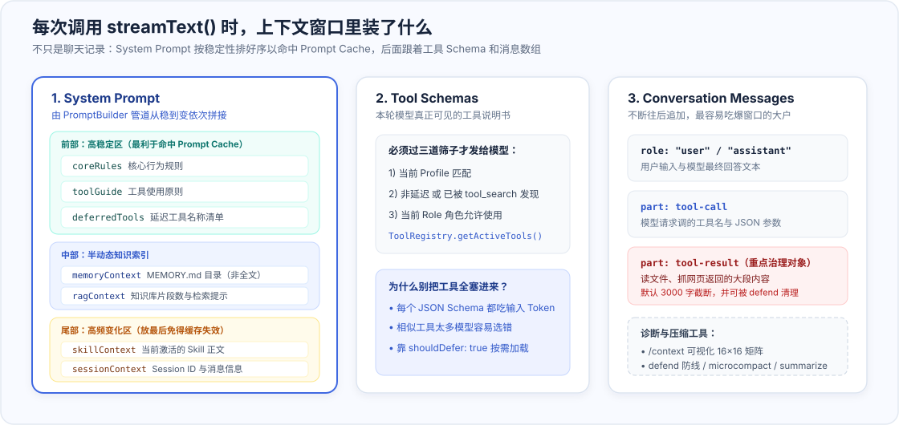

# 03. 上下文工程：有限窗口里的精打细算

很多人刚学 Agent 时觉得“只要模型支持 128k 甚至 1M 上下文，全往里塞就行”。实际一跑就会发现：塞得越多，延迟越高、账单越贵，而且模型越容易被几千行过时输出带偏注意力。这一章看 SuperAgent 怎么管住发给模型的每一段信息。

## 3.1 发给模型的上下文里到底有什么

每次调用 `streamText()` 时，模型收到的绝不只是一句聊天记录，而是三大块拼出来的现场（点击图片可放大）：



## 3.2 `PromptBuilder`：像流水线一样拼 System Prompt

不要把几百行 System Prompt 写死在一个大字符串模板里。`src/context/prompt-builder.ts` 用了一个管道模式，在 `src/main.ts` 里按顺序挂了 7 段：

```ts
const builder = new PromptBuilder()
  .pipe('coreRules', coreRules())
  .pipe('toolGuide', toolGuide())
  .pipe('deferredTools', deferredTools())
  .pipe('memoryContext', memoryContext(memoryStore))
  .pipe('ragContext', ragContext(vectorStore))
  .pipe('skillContext', () => skillLoader.buildPromptSection(activeSkills))
  .pipe('sessionContext', sessionContext());
```

每一段就是一个小函数：接收 `PromptContext`，返回字符串或 `null`（没内容就跳过），最后用空行拼起来。这样做的好处很现实：哪一段不需要可以随时摘掉、每段可以单独写测试，而且哪天加了个新模块直接 `.pipe()` 塞进来就行。

> **顺带看清一个占位细节**：`main.ts` 里的 `makePromptCtx()` 第 189 行目前写死了 `sessionMessageCount: 0`，所以 System Prompt 里打印的会话消息条数目前一直显示为 0，没有取真实的 `messages.length`。

## 3.3 稳定前缀与 Prompt Cache（省钱的关键技巧）

主流模型供应商（包括 Qwen、Claude、OpenAI）都支持 **Prompt Cache**：如果这次请求开头那一大段内容跟上次一模一样，供应商会直接复用缓存里的中间计算状态，输入单价大幅打折、首字延迟也更低。

所以 `PromptBuilder` 排管道顺序有个黄金法则——**越稳定的放越前面，越容易变的放越后面**：

```text
[前部] 固定规则 → 工具指南 → 半动态的记忆/RAG摘要 → 每轮可能变的 Skill / Session [后部]
```

千万别把 `new Date().toISOString()`（精确到秒的当前时间）或随机数直接贴在 System Prompt 最顶部！否则每一轮前缀哈希都会变，后面的缓存全作废。你可以在 `src/mock-model.ts` 里看到项目专门用前缀哈希模拟了 `cache write` 和 `cache hit`，直观感受前缀变化对费用的影响（还可以用 `/cache off` 和 `/cache on` 对比开关效果）。

## 3.4 Session 持久化：JSONL 为什么好用，以及当前缺了哪半截

`src/session/store.ts` 把对话历史保存在 `.sessions/<sessionId>.jsonl`。

**JSONL**（JSON Lines）就是“每一行是一个独立 JSON 对象”的纯文本格式。对日志和对话记录来说，它比一整个大 JSON 数组好用太多：
- 新来一条消息只需 `appendFile` 往文件末尾追加一行，不用把整份历史读出来重新序列化；
- 万一进程崩溃写坏了最后一行，读取时按行 `JSON.parse` 跳过坏行就行，前面几百轮数据照样完好；
- 终端里直接 `tail -n 20` 就能看最新消息。

**但一定要注意仓库现状**：`SessionStore.load()` 方法已经写好了，不过 `src/main.ts` 每次启动依然是 `let messages: ModelMessage[] = []`——也就是说**目前只管写、不管读**，哪怕跑 `pnpm run continue` 也不会把上次聊的恢复回来（第 08 章的实验 9 就是专门带你把这半截接上的）。

## 3.5 上下文是怎么一步步膨胀失控的

实际跑十来轮任务后，占大头的往往不是你和模型打的那几句文字，而是：
1. 调 `read_file`、`grep`、`web_fetch` 留下的一长串 `tool-result`；
2. 模型执行多步循环时产生的中间思考和参数；
3. 工具越来越多之后塞进来的大量 Tool Schema。

为了压住膨胀，项目里准备了两套工具模块——不过在看代码前先记住一句话：**它们都已经实现了，但默认主循环还没有自动调用**。

## 3.6 两种压缩思路：`Microcompact` vs `LLM 摘要`

都在 `src/context/compressor.ts` 里：

1. **Microcompact（机械清理，零额外模型费用）**
   - 思路：最近几轮的工具结果通常还要用，保留；更早之前的旧 `tool-result`（比如 10 轮前读过的某个大文件内容）直接替换成一条简短占位符（如 `[已清理较早的工具输出]`）。
   - 适用场景：那些“真要再用随时能再调工具重读一遍”的观察结果。坏处是没有语义判断，万一早期读过一份关键报错后面还要引用，会被清掉。

2. **LLM Summarize（大模型摘要压缩）**
   - 思路：保留最近 6 条消息不动，把更早的对话序列化之后发给模型，按固定模板总结成“用户目标、已做操作、关键发现、遗留问题”。
   - 风险：摘要模型可能漏掉某个精确文件路径或报错码；原有 `tool-call` / `tool-result` 的结构关系也会在总结后消失；反复摘要多次还会像复印机一样逐渐失真。

## 3.7 三层即时防线（`src/context/defense.ts`）

除了调用大模型做摘要，项目在 `src/context/defense.ts` 写了一套无需模型、毫秒级执行的三层清理器（也是全仓库唯一写了正式单元测试 `src/context/defense.spec.ts` 的模块）：

- **截断超长历史结果**（`truncateToolResults`）：注意它和第 02 章 `ToolRegistry` 截断分工不同——Registry 管的是“工具刚跑完那一刻”，Defense 管的是“历史数组里已经攒了一堆老工具结果，再收紧一次”；
- **TTL Prune（按过期时间修剪）**：根据 `timestamps` 记录的消息时间，把太久以前的旧输出先软修剪、再硬清除；
- **`TokenTracker`**：拿 API 返回的真实 Token 作为基线，再用字符数变化推算增量，比每次全量遍历更准。

目前这些被打包在 `applyDefense()` 里，终端里手动输入 `defend`（或 `执行防线`）就能触发一次，查看前后对比。

## 3.8 `/context` 矩阵与 `/usage` 账单怎么看

项目模仿 Claude Code 做了一个很直观的终端工具 `src/context/view.ts`：

输入 `/context` 后，程序会把 100 万假想窗口切成 16×16 共 256 个小方块，用不同颜色标出 System Prompt、System tools、Memory、Messages 各自占了几格。

> **看源码才注意到的两个小细节**（`src/commands/context.ts`）：
> 1. `skillsChars` 目前硬编码成了 `0`，所以就算加载了 Skill，右侧图例也不会单列 `Skills` 一行，它的长度实际上算进了 `System prompt` 那一格里；
> 2. 顶部显示的模型名字只判断了环境变量 `process.env.DASHSCOPE_API_KEY`，写死了 `Qwen Plus` / `Mock Model`，不随配置文件里的 `model.name` 改变。

而 `/usage` 读取的则是 `src/usage/tracker.ts` 累加的结果，用来看缓存命中率 bar 和“如果没有缓存得多花多少钱”。记住主程序里 `.usage/today.jsonl` 路径是硬编码的（没读取配置里的 `usage.trackingFile`），且这只是一个字符/Token 估算观察面板（不同语言和 JSON 的换算比例不同）。

## 3.9 一套接地气的上下文治理顺序

如果以后你自己从头搭一个 Agent，按开销从低到高排优先级最划算：

1. **源头限流**：工具刚返回时就截断超长输出（`ToolRegistry`）；
2. **工具瘦身**：不常用的大工具走 `shouldDefer` 延迟发现；
3. **机械清理**：把陈旧的可重取工具结果清掉（`microcompact` / `TTL`）；
4. **模型摘要**：实在聊太长了再用 LLM 压缩早期历史（`summarize`）；
5. **开新会话**：把总结好的稳定结论写进 `.memory/`，然后干脆清空 `messages` 重新开一局。

## 3.10 动手试一试（看前后数字变化）

启动 `pnpm start` 后，直接用内置的调试命令造一波“假长对话”，感受上下文防线是怎么省 Token 的：

```text
/context
sim
/context
defend
/context
/usage
```

你会看到终端打出一张类似下面的对比（以实际输出为准）：

```text
--- 执行三层防线 ---
  [Layer 2] 截断: ... 条, 预算清理: ... 条
  [Layer 3] 软修剪: ..., 硬清除: ...
  [结果] ~xxxx → ~yyyy tokens (节省 zzzz)
```

再去项目根目录下看看刚才自动生成的 `.sessions/default.jsonl` 和 `.usage/today.jsonl` 里面到底存了什么。

## 3.11 本章自检

1. System Prompt 里的各段顺序如果随便打乱（比如把动态时间放第一行），会破坏什么能力？
2. `ToolRegistry` 里的 `truncateResult` 和 `defense.ts` 里的 `truncateToolResults` 分别在什么时候起作用？
3. 为什么项目要用 `.jsonl` 而不是单个 `.json` 数组存 Session 历史？
4. 为什么代码里写好了 `microcompact()` 和 `summarize()`，但目前执行 `sim` 时不会自动压缩？
5. 为什么 Memory 是只放“索引”进 System Prompt，而不是把所有记忆全文塞进去？

<details>
<summary>参考思路（点击展开）</summary>

1. 会破坏供应商的 Prompt Cache 命中率。只要开头的字节变了，后面所有本该复用的前缀都要重新计算并按全价计费。
2. 前者在工具刚执行完返回结果的那一刻立刻生效，防止单次结果过大；后者在历史消息积压过多时对已经存在 `messages` 数组里的旧工具结果做二次压缩。
3. JSONL 可以直接向文件尾部追加一行，无需每次整份读取再重写；某一行意外损坏也不会导致整个历史文件解析失败。
4. 目前 `agentLoop()` 尚未把 `compressor.ts` 接进自动触发逻辑里，当前必须通过 `defend` 命令手动触发 `applyDefense()`（或自己接进主循环）。
5. 长期记忆会随时间不断增多，全部塞进 System Prompt 会持续占用每轮请求的基础 Token；只放轻量的 `MEMORY.md` 目录索引，等模型真正需要时再去调 `memory read/search` 按需读取，最省窗口。

</details>
