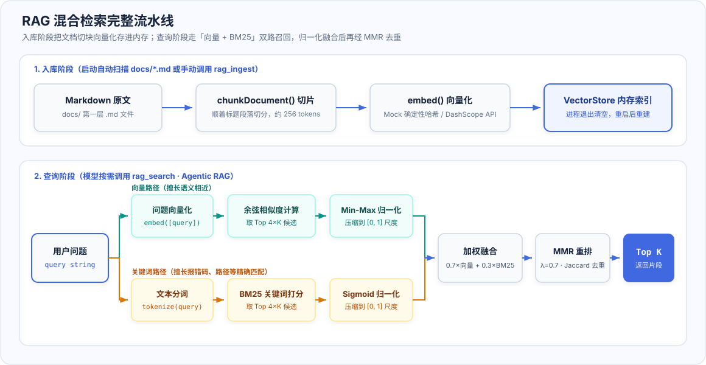

# 04. 记忆与 RAG：两种完全不同的“知道”

初学者写 Agent 最容易混淆的一对概念就是 RAG 和 Memory：看着都是“帮模型查它原本不知道的东西”，为什么还要拆成两套完全不同的模块？

## 4.1 先把这两个概念彻底分清

| 维度 | RAG（知识库检索） | Memory（长期记忆） |
| --- | --- | --- |
| 存的是什么 | 外部客观文档、规范手册、代码说明 | 对话中沉淀下来的用户偏好、踩坑反馈、团队约定 |
| 典型提问 | “部署告警阈值配多少？” | “用户之前要求代码注释用英文还是中文？” |
| 底层长相 | 文档切片（Chunk）+ 数值向量 | 带 Frontmatter 元数据的 Markdown 小文件 |
| 怎么搜 | 向量相似度 + BM25 关键词 + MMR 去重 | BM25 关键词（按标题、描述加权） |
| 当前存在哪 | 内存数组 `VectorStore`（重启会重新建） | 硬盘 `.memory/` 目录（跨重启永久留存） |
| 谁往里写 | 启动自动导入 `docs/*.md` 或 `rag_ingest` | 模型主动调 `memory(save)` 或你手动建文件 |

一句话记住：**RAG 查的是“白纸黑字写好的资料”，Memory 记的是“咱俩长期磨合出来的默契”**。

## 4.2 RAG 完整流水线怎么跑

整个过程分“入库”和“查询”两步（对应 `src/rag/` 下 4 个文件，点击图片可放大）：



### 1. 文档切片（`src/rag/chunker.ts`）
整篇文档直接算一个向量，信息全糊在一起根本搜不准。`chunkDocument()` 会尽量顺着 Markdown 标题和段落边界，把文章切成每块大约 256 Token（按 1 Token ≈ 4 字符粗算）的 `Chunk`。

这是一个极简的教学切分器，没有做相邻切片重叠窗口（overlap），也没有复杂的语义断句——优点是一眼能看懂，缺点是刚好跨段的一句话可能被劈开。

### 2. Embedding 向量化（`src/rag/embedder.ts`）
Embedding 把一段文字压成一串浮点数向量，语义相近的句子在空间里夹角更小（用余弦相似度计算）。

项目准备了两套实现：
- **Mock Embedder**：无 Key 时按文本字符算一个确定性的假向量——保证“同一句话每次向量相同”、能跑通整个流程，但**并不懂同义词语义**；
- **DashScope Embedder**：有 Key 时请求外部接口。注意：进程内做了文本级缓存防止重复计费，但没有做容量淘汰，且发送文本到外部接口前一定要确认文档不涉密。

### 3. 内存 `VectorStore`（`src/rag/store.ts`）
别被名字唬住，这里的 `VectorStore` 本质上就是包了一个 JavaScript 数组！它没有接 SQLite 或 Milvus，进程一退出索引就没了；下次 `pnpm start` 时 `src/main.ts` 会重新扫描 `docs/` 第一层的 `.md` 文件再算一遍。

## 4.3 为什么光有向量检索还不够（混合检索 + 归一化 + MMR）

刚接触 RAG 时常以为“把文本变向量算余弦相似度不就完了？”——真用起来立马遇到三个翻车点，代码在 `src/rag/search.ts` 里逐个演示了怎么补救：

1. **为什么还要拼一个 BM25 关键词检索？**
   向量擅长理解“机器挂了怎么办”和“服务崩溃如何恢复”是一个意思，但遇到**精确报错码（`ERR_CONNECTION_REFUSED`）、函数名、接口路径 `/api/v2/users`、版本号**时，纯向量经常搜不准。BM25 专攻字面精确匹配，两条路各取 `topK * 4` 个候选合一块，互补短板。
2. **为什么不能直接 `0.7 * 向量分 + 0.3 * BM25分`？**
   因为两种分数的量纲完全不同：余弦相似度一般在 `[-1, 1]`（实际大多 `0.2~0.9`），BM25 分数可能是 `0` 到 `十几` 甚至更高，直接相加等于被 BM25 碾压。所以代码先用 **Min-Max** 把向量分压到 `[0, 1]`，用 **Sigmoid** 把 BM25 分也压到 `[0, 1]`，再按 `0.7 × vector + 0.3 × keyword` 融合。
3. **为什么还要做 MMR（最大边际相关性）去重？**
   假设某份文档连续三段都在讲同一个告警规则，单纯按高分取 Top 5，可能一口气全返回同一段附近高度重复的切片。MMR 的公式：
   ```text
   MMR = λ × 相关性分数 - (1 - λ) × 与已选结果的最大文本重叠度（Jaccard）
   ```
   这里 `λ = 0.7`，意思是在挑第 2、3、4 条结果时，如果它跟前面挑出来的太像（词集合重合度高），就扣点分，把机会让给另一个角度的相关切片。

## 4.4 Agentic RAG：不强迫每句话都查库

注意看 `src/context/prompt-pipes.ts`：启动后 System Prompt 里**并不会**每轮自动拿用户的话去搜知识库然后硬塞进上下文，它只是告诉模型“知识库里有 X 个片段，需要查资料时自己调用 `rag_search`”。

当用户说“你好”时，模型直接回复，零检索开销；当用户问“部署告警阈值是多少”时，模型自己调 `rag_search`。这就是现在主流的 **Agentic RAG** 模式。

## 4.5 Memory：文件即记忆的透明设计

与存在内存里的 RAG 不同，`src/memory/store.ts` 把每条记忆都写成 `.memory/` 目录下一个人类直接能打开修改的 Markdown 文件：

```markdown
---
name: typescript-preference
description: 用户偏好 TypeScript
type: user
lastWriteAt: 1730000000000
lastReadAt: 1730000000000
---

用户在示例和实现中优先使用 TypeScript。
```

- 分成 4 类：`user`（用户习惯/背景）、`feedback`（用户纠正过别干什么）、`project`（代码里看不出来的项目决策）、`reference`（外部链接线索）；
- 目录下还有一份精简的总目录 `MEMORY.md`（最多 200 行）。只有这份目录会常驻 System Prompt；模型觉得哪条有用，再调 `memory` 工具去 `read` 全文（单条最多读 4000 字符）；
- 系统 prompt 还专门叮嘱模型：**“记忆只是旧线索，不一定是当前事实，动手前先用文件工具核实一下。”**——防止代码已经改了、Agent 还死守着半个月前的过时记忆胡说。

### Memory 搜索、体检（`/lint`）和整理（`/dream`）
- **搜索**（`src/memory/search.ts`）：使用 BM25 算法，英文按单词切、中文按单字切（非常朴素，但短记忆够用），并把名称重复 3 次、描述重复 2 次来提高元数据权重；
- **体检**（`src/memory/validator.ts`）：检查 Frontmatter 是否完整、超过 30 天未读的旧记忆、以及正文里提到的文件路径在硬盘上是不是已经删了；
- **整理**（`src/commands/dream.ts`）：输入 `/dream` 后，程序发一段四阶段指令让模型自己先 `lint`、再把失效或重名的记忆 `delete` / `save` 合并。自动删长期记忆存在误删风险，所以真实项目里一般会让它先出计划让人点确认。

> **记住什么、不记什么**：偏好、纠正、业务决定值得记；`package.json` 里能查到的依赖、Git 提交记录、密钥和一次性日志报错**千万别往 Memory 里写**。

## 4.6 动手试一试（Mock 模式即可）

启动 `pnpm start`，分别测试 RAG 和 Memory：

```text
/rag
部署时 CPU 告警阈值是多少？
API breaking change 有哪些规则？
```

再试试写入、搜索和体检记忆（**注意：终端体检命令是 `/lint`，不是 `/memory lint`**）：

```text
请记住：我学习本项目时希望先讲原理，再看源码。
/memory
/memory search 学习
/lint
```

退出程序再重启 `pnpm start` 后再输入 `/memory` 和 `/rag`，对比看看：为什么刚才记住的偏好还在，而如果你想手动导入文档（`ingest <路径>`）又发生了什么？（小提示：如果在 `/role guest` 模式下跑 `ingest` 命令，由于 `guest` 没有 `rag_ingest` 权限，当前 `src/commands/rag.ts` 会报空指针错，做实验时记得保持在 `owner` 角色。）

## 4.7 本章自检

1. 如果用户问“怎么联系管理员”，应该放进 RAG 还是 Memory？如果用户说“以后别给我生成英文注释”，呢？
2. 为什么混合检索时一定要做分数归一化，不能直接拿原始分数相加？
3. MMR（最大边际相关性）能帮你搜出原本搜不到的文档吗？它真正解决什么问题？
4. 为什么代码里 Memory 每次 `read` 都要更新文件里的 `lastReadAt` 时间戳？
5. 为什么要在 Prompt 里提醒模型“记忆只是线索，使用前仍需验证”？

<details>
<summary>参考思路（点击展开）</summary>

1. 文档里的固定联系信息属于客观资料，放 RAG；“以后别生成英文注释”是用户反馈与个人偏好（`feedback`/`user`），应存进 Memory。
2. 余弦相似度和 BM25 分数不在同一数值尺度上（BM25 可以大于 1 甚至达到十几），不归一化就直接加权，高数值的一方会完全淹没另一方。
3. 不能提高“底层召回率”（它只对已经召回的候选做重排），它解决的是“Top K 结果里好几条高度重复、信息冗余”的问题。
4. 用于判断某条记忆是不是长期沉睡/过期了（结合 30 天阈值在 `lint` 和 `/dream` 时识别僵尸记忆）。
5. 因为仓库代码和外部环境随时都在变，三个月前记下的某个模块路径或接口约定今天可能已经删了或改名了，直接盲信会导致幻觉和报错。

</details>
