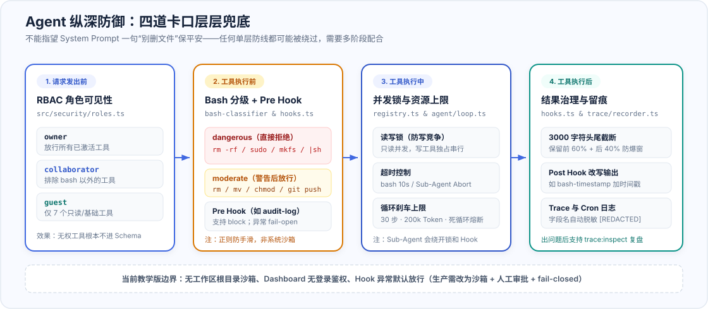

# 06. 安全边界、定时任务与 Multi-Agent

一旦允许 Agent 写文件、执行 `bash`、半夜自己跑定时任务，出事的后果就不再只是“胡说八道”，而是真的把目录删了或者死循环烧钱。这一章看项目怎么用四层约束兜底，再看清楚 Cron 和子 Agent 是怎么把主循环复用到异步场景里的。

## 6.1 安全不是靠 Prompt 喊口号，而是四层卡口

光在 System Prompt 里写一句“请不要删除重要文件”是不管用的——模型随时可能因为上下文长了、被网页里的恶搞文本带偏（Prompt Injection）而照删不误。

项目按执行阶段放了四层防护（`src/security/` + `src/tools/registry.ts`，点击图片可放大）：



### 第一层：角色权限（`src/security/roles.ts`）
系统定义了三档角色：
- `owner`：全部工具放行；
- `collaborator`：除 `bash` 之外放行；
- `guest`：只允许 `get_weather`、`calculator`、`read_file`、`list_directory`、`glob`、`grep`、`rag_search` 这 7 个只读工具。

这招好在**从源头剥夺可见性**：切到 `guest` 后，`bash` 的 Schema 根本不会出现在发给模型的工具列表里。

> **两个实操局限**：
> 1. **按工具名粗粒度管控，不管参数路径**：`guest` 依然能用 `read_file` 去读项目外的敏感路径；而插件新注册的 `supabase__insert` 也会因为 `collaborator` 是“黑名单排除 `bash`”而被放行；
> 2. **配置未接线**：`config/schema.ts` 里 `security.defaultRole` 的默认值还是 `'developer'`（根本不在 `Role` 类型里），且 `main.ts` 并没有读它，所以 `ToolRegistry` 默认永远以 `owner` 启动。

### 第二层：Bash 风险分类（`src/security/bash-classifier.ts`）
在命令送进 `execSync()` 前，用几条正则分成三档：
- `safe`：正常放行；
- `moderate`（如 `rm`、`mv`、`chmod`、`kill`、`git push`）：终端打一行黄色警告，但继续执行；
- `dangerous`（如 `rm -rf`、`sudo`、`mkfs`、`curl ... | sh`）：直接返回 `[拒绝执行] ...`，根本不进 `execSync`。

切记：**正则识别只能防君子或防模型手滑，不是操作系统沙箱**。换个别名、写进脚本里跑、或者用 `node -e` 一样能绕过正则。生产级安全必须靠容器隔离、工作目录限制、最小操作系统权限和人工审批弹窗。

### 第三层：Hook Pipeline（`src/security/hooks.ts`）
`main.ts` 注册了两个示例 Hook：
- Pre Hook `audit-log`：调 `write_file`/`edit_file` 前打印一行审计路径；
- Post Hook `bash-timestamp`：给 `bash` 输出的开头拼一行 ISO 时间戳。

要注意代码里的两个实现细节：
1. **异常是 `fail-open` 的**：如果某个 Hook 自己写错了抛异常，`HookPipeline` 会 `console.error` 一声然后放行主工具继续跑（真实安全拦截 Hook 通常需要 `fail-closed`，出错就阻断）；
2. **源码里一个小 Bug**：`src/security/hooks.ts` 的 `runPre()` 末尾直接写了 `return { action: 'allow' };`，忘了把循环里改写的 `currentInput` 作为 `modifiedInput` 带出来——虽然 `ToolRegistry` 写了接收 `modifiedInput` 的分支，但目前在 Pre Hook 里返回 `action: 'modify'` 实际上不会改掉传给工具的参数（而 `runPost()` 第 64 行则是正确返回了 `modifiedOutput`）。

## 6.2 Cron 定时任务：让 Agent 自己按点醒来

`src/cron/` 实现了一套轻量的进程内调度器，既可以跑固定函数（`handler`），也可以到点唤醒一次完整的 `agentLoop`（`agent`）。

- **支持三种调度写法**（`src/cron/parser.ts`）：标准 Cron 表达式（`0 9 * * *`，靠 `croner` 算下次时间）、间隔写法（`every 10m` / `every 30s`）、一次性 ISO 时间戳。
- **为什么不用 `setInterval()`？**：项目每次都是算好下一次毫秒数后用一次 `setTimeout()`，**等这次任务跑完了再排下一次**。好处是万一某个 Agent 任务一跑就是 2 分钟，不会和上一次重叠撞车（还专门加了防重入标记）。
- **任务存储与自动熔断**：任务配置存在 `.cron/jobs.json`，执行日志追加到 `.cron/logs.jsonl`。如果一个任务连续失败达到 `maxRetries`（默认 3 次），系统会自动把 `enabled` 置为 `false` 停掉，防止报错死循环。

**当前的真实边界**：
- 依赖当前 `pnpm start` 进程一直开着，关机或退出期间错过的任务重启后不会补跑；
- 当前内置 `handler` 只有 `random-quote`；
- `main.ts` 里注入给 `CronService` 的 `runAgentPrompt(prompt, timeout)` 虽然接收了 `timeout` 参数，但调 `agentLoop()` 时并没有把它包成 `AbortController` 传进去，所以 Cron 任务的超时保护目前还没真正生效。

## 6.3 Sub-Agent：为什么主 Agent 要“派分身”干活

假设你让主 Agent “把 `src/rag`、`src/memory`、`src/context` 三个模块分别读一遍再对比”。如果全由主 Agent 自己一步步读，几十个文件塞进主 `messages` 里，上下文瞬间爆炸，而且只能串行慢慢读。

`src/agents/spawn.ts` 的解法是 **分治 + 上下文隔离**：
1. 主 Agent 调用 `spawn_agent` 工具，把 3 个子任务同时派发出去（`spawnParallel` 用 `Promise.all` 并行跑，受 `maxConcurrent` 默认 3 限制）；
2. **每个子 Agent 都有全新的空白 `messages = [{ role: 'user', content: task }]`**，不带主对话的历史包袱；
3. 子 Agent 在工具集里**主动排除了 `spawn_agent`**（`EXCLUDED_TOOLS`），防止子 Agent 无限套娃继续往下派孙子 Agent（所以虽然 `SubAgentRegistry` 定义了 `maxSpawnDepth`，目前实际只有 1 层）；
4. 跑完后只把子 Agent 最后一条文本总结带回给主 Agent，中间读了十几个文件的过程全留在子 Agent 自己的局部变量里直接销毁。

> **对照源码的 2 个重要细节**：
> 1. **最大步数代码与变量名不一致**：`src/agents/spawn.ts` 第 14 行定义了一个没用上的 `const SUB_AGENT_MAX_STEPS = 10;`，但第 51 行实际写死的是 `const maxSteps = 30;`（最后第 30 步会强制 `toolChoice: 'none'` 逼子 Agent 输出文字总结）；
> 2. **并行背后的竞争代价**：第 65 行特意调用 `ctx.registry.toAISDKFormatUnlocked()`——**刻意绕开了读写锁和 Hook**，就是为了让多个子 Agent 能真正并行。如果同时派两个子 Agent 去读代码，速度翻倍；但如果同时派两个子 Agent 去改同一个文件，就会发生覆盖竞争。

## 6.4 动手试一试（注意区分 Mock 和真实模型）

### 在 Mock 模式下可直接验证（安全权限 & Hook）

启动 `pnpm start` 后输入：

```text
/role guest
读取 package.json
测试bash
/role owner
/hooks
测试bash
测试危险
/cron
/agents
```

仔细观察：
- `guest` 下输入 `测试bash` 时，模型其实在 Mock 里想调 `bash`，但 `bash` 根本不在可见工具里会发生什么？（在 Mock 模式下，由于 `guest` 没 `bash`，AI SDK 会直接抛出找不到该工具的错误并被 `main.ts` 捕获打印 `[Agent] ...`；而在真实模型里，模型压根看不到 `bash`，会直接用文字拒绝你。）
- 切回 `owner` 后输入 `测试bash`，会看到输出开头多了 `[2026-...]` ISO 时间戳（Post Hook）；输入 `测试危险`（对应 Mock 里的 `rm -rf /tmp/test-data`），会被拦截打印 `[拒绝执行] 检测到危险操作...`。

### 需要接真实模型（`DASHSCOPE_API_KEY`）才能体验的部分

由于 `src/mock-model.ts` 没有内置 `cron_manage` 和 `spawn_agent` 的关键词匹配，下面两句请在接好真实 DashScope API Key 后再测：

```text
帮我创建一个每 1 分钟输出随机名言的任务（handler 用 random-quote）
帮我并行对比 src/rag、src/memory 和 src/context 三个模块的职责
```

跑完后敲 `/cron`、`/cron logs` 和 `/agents` 查看任务状态与子 Agent 并发汇总结果（测试完别忘了让模型调 `cron_manage` 删掉刚才的定时任务，或者手动清理 `.cron/jobs.json`）。

## 6.5 本章自检

1. `Role` 过滤和 `Bash` 风险分类，哪一个更早生效？各自防的是什么风险？
2. 当前 `HookPipeline` 如果某个 Hook 内部报错崩溃，会阻断工具执行吗？生产环境应该怎么选？
3. 为什么 Cron 调度器采用“每次 `setTimeout` 跑完再排下一次”，而不是直接 `setInterval`？
4. 子 Agent 为什么能够把主 Agent 的上下文压力降下来？
5. 为什么说不要同时派两个子 Agent 去修改同一个文件？

<details>
<summary>参考思路（点击展开）</summary>

1. `Role` 过滤更早：在调用模型之前就从 `getActiveTools()` 把无权工具的 Schema 拿掉了，防的是“模型看到并使用越权工具”；`Bash` 分类在模型发出 `tool-call` 之后、真正 `execSync()` 之前生效，防的是有 `bash` 权限的角色（如 `owner`）执行明显危险的命令。
2. 不会阻断（`fail-open`），`try/catch` 打完错误日志后继续放行。审计日志类 Hook 可以 `fail-open`，但安全拦截类 Hook 生产上应该 `fail-closed`（Hook 异常宁可拒绝执行，也不能裸奔放行）。
3. `setInterval` 不管上一次任务有没有跑完，到点就硬触发，容易造成同一个耗时任务重入并发；单次 `setTimeout` 跑完再排下次能天然避免叠罗汉。
4. 因为每个子 Agent 只拿一个空白 `messages` 数组去读大量文件、调十轮工具，最后只把精炼后的一段文本结论还给主 Agent，中间繁杂的 `tool-result` 不会污染主对话窗口。
5. 一是因为它们各自的上下文互相看不见对方改了什么；二是因为 `spawnAgent` 调用的是 `toAISDKFormatUnlocked()`，绕开了 `ToolRegistry` 的独占锁，并发写同一个文件会直接互相覆盖。

</details>
