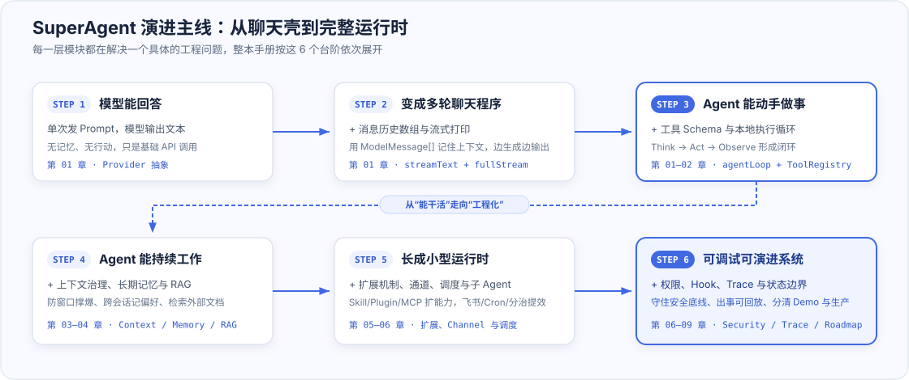

# SuperAgent 源码学习手册

这套手册写给两类人：
- 已经对聊天机器人有点概念，但还没亲手拆过一个完整 Agent 系统的人；
- 刚拉下这个仓库，想边跑、边改代码，把 **Agent Loop、工具调用、上下文、记忆/RAG、安全与调度** 真正串起来的人。

阅读时尽量始终带着一个标尺——区分清楚代码里**“已经跑通主流程的”**和**“写好了模块但还没接进主线的”**。教学仓库为了保持体积可控，很多生产细节只做成了最小示范，手册会在对应章节如实标明，不把 Demo 代码包装成生产方案。

## 读完能搞懂哪些核心问题

1. 为什么普通的多轮聊天程序还算不上 Agent？
2. 模型明明不能直接操作本地文件，它是怎么一步步把 `read_file`、`bash` 调起来的？
3. `agentLoop` 怎么形成 `思考 → 行动 → 观察` 的闭环，失控了又靠什么刹车？
4. 为什么工具注册得越多，模型反而越容易选错或烧钱？`Tool Search` 怎么缓解这个问题？
5. 发给模型的那一大坨上下文里，Prompt、工具定义、RAG 和长期记忆各占哪块地盘？
6. RAG 和 Memory 到底差在哪？为什么向量检索还要硬凑一个 BM25 和 MMR？
7. Skill、Plugin、MCP、Channel 四种扩展分别改系统的哪一层？
8. 给了 Agent 读写文件和跑命令的权限后，怎么用角色、Hook 和命令识别兜住底线？
9. Cron 定时任务和 Sub-Agent 子任务是如何复用同一套 Agent 能力的？
10. 出问题时，怎么靠 Session、Trace 和 Usage 三份不同的记录定位真相？

## 建议的阅读顺序

| 阶段 | 文档 | 重点搞明白什么 |
| --- | --- | --- |
| 0 | [阅读指南与整体架构](./00-guide-and-architecture.md) | 建立全局地图，看清一条终端消息穿过哪些模块 |
| 1 | [从模型调用到 Agent Loop](./01-model-and-agent-loop.md) | 流式事件、多步循环、重试退避、死循环检测 |
| 2 | [工具系统](./02-tool-system.md) | `ToolDefinition`、读写锁、截断、Hook 和 `tool_search` |
| 3 | [上下文工程](./03-context-engineering.md) | `PromptBuilder` 管道、Prompt Cache、压缩与三层防线 |
| 4 | [记忆与 RAG](./04-memory-and-rag.md) | 混合检索（向量 + BM25 + MMR）与 Markdown 长期记忆 |
| 5 | [Skills、Plugins、MCP 与 Channel](./05-extension-and-channel.md) | 四种扩展边界，以及飞书/Dashboard 怎么复用主循环 |
| 6 | [安全、Cron 与 Multi-Agent](./06-security-cron-multi-agent.md) | 纵深防御、定时调度生命周期、子 Agent 并行分治 |
| 7 | [配置、命令、启动与可观测性](./07-runtime-and-observability.md) | 启动关闭顺序、命令行分发、Trace 排查故障 |
| 8 | [18 组实践实验](./08-hands-on-labs.md) | 从零启动到动手加工具、写插件、接通历史恢复 |
| 9 | [现状、限制与演进路线](./09-limitations-and-roadmap.md) | 盘点 Mock 项、未接线配置和生产化缺口 |
| 附录 | [命令、工具、Mock 口令与源码索引](./appendix-reference.md) | 查命令、查环境变量、查 Mock 触发词、按文件找章节 |

## 怎么学最有效

光看文字很容易“感觉自己懂了”，真要落地还是要**先猜、再跑、最后对照源码**：

1. 每章先看开头的**问题和流程图**，自己在脑子里猜一下代码该长啥样；
2. 打开章节里标出的 `.ts` 文件（单文件都很短，大多一两百行），对照着看实现；
3. 按章末或第 08 章的实验命令跑一遍，看看终端实际打出来的日志；
4. 试着改一个小参数（比如把某个工具的 `isConcurrencySafe` 改成 `false`，或把某个数值调小），观察终端现象是不是跟你想的一样；
5. 合上文档，用自己的话答一遍章末的**自检题**，再点开参考思路对答案。

## 动手前先解决环境与常见卡点

项目锁定了 **Node.js 22** 和 **pnpm 10.33.0**。如果本地 pnpm 版本不一致，先运行 `corepack enable`。无 API Key 即可启动：

```bash
pnpm install
pnpm start
```

### 初学者最容易踩的 5 个坑

1. **为什么启动时 3000 端口报错（`EADDRINUSE`）？**
   即使没配飞书，Dashboard 默认也会监听 3000 端口。建一个 `.env`（可先 `cp -n example.env .env`）并在里面写 `FEISHU_PORT=3001` 换个端口即可。
2. **为什么配了 `.env` 里的 `DASHSCOPE_API_KEY`，启动后还是 Mock 模式？**
   代码读的是 `super-agent.config.json` 里的 `model.apiKey`。如果没跑 `pnpm run init` 生成 `"${DASHSCOPE_API_KEY}"` 这行引用，默认配置的 `apiKey` 是空字符串，依然会进 Mock。反之，如果 JSON 里写了 `"${FOO}"` 但 `.env` 里根本没有定义 `FOO`，配置加载器会保留字面量 `"${FOO}"`，程序反而会误判为“已有 Key”去请求真实接口然后报错。所以最稳妥的做法是：`cp -n example.env .env`（里面变量默认是空的 `DASHSCOPE_API_KEY=`），再跑 `pnpm run init` 且向导里留空 Key。
3. **为什么有些命令带 `/`，有些不带 `/`？**
   这是仓库开发过程中的历史习惯：主功能命令大多带 `/`（如 `/context`、`/memory`、`/lint`、`/rag`、`/role`），而几个早期调试命令和快捷操作不带 `/`（如 `ingest <路径>`、`defend`、`sim`、`status`、`exit`）。具体以命令分发代码和[附录](./appendix-reference.md#a2-交互命令)为准。
4. **为什么在 Mock 模式下，我问的问题它总是回“你好！我是 Super Agent…”？**
   `src/mock-model.ts` 不是真正的语言模型，它靠**固定关键词**猜你要调什么工具（比如 `测试并发`、`读取 package.json`）。它甚至没有内置 Cron 和 Sub-Agent 的 Mock 触发词，这两块必须接真实 Key 才能让模型主动调用。完整口令表见[附录 Mock 触发口令](./appendix-reference.md#a4-mock-模式触发口令速查)。
5. **为什么 `docs/` 目录下还有 `api-design.md` 和 `deployment-guide.md`？**
   那两份是**故意放进去的假公司文档**，用来给启动时的 RAG 知识库提供测试语料（里面写的 PostgreSQL、PM2、build 脚本都不是 SuperAgent 自身的功能）。启动代码只会扫描 `docs/` 第一层的 `.md`，不会把 `docs/learning/` 扫进知识库，所以这两套文档互不干扰。

### 本地用浏览器看这套手册

直接用浏览器打开 `docs/learning/index.html`（`file://` 协议）会被跨域策略拦住，看不到内容。在仓库根目录起个临时静态服务就行：

```bash
python3 -m http.server 8000
```

然后打开 `http://localhost:8000/docs/learning/`（注意页面引用了 `cdn.jsdelivr.net` 加载 Docsify，首次加载需要联网）。

## 总体演进主线

整套源码其实在回答一个问题——**怎么把一个“只会接话的模型”一步步改造成“能干活、守规矩、可排查的小型系统”**（点击图片可放大）：


